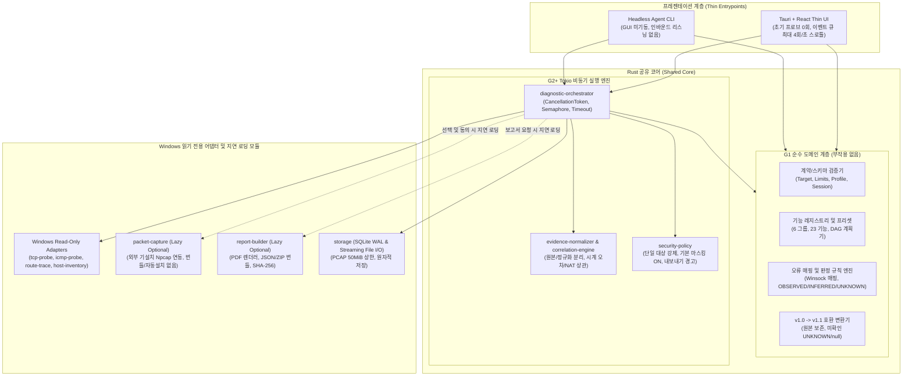

# Network Path Inspector (NPI) 시스템 아키텍처 및 G0 승인 경계

- 문서 버전: 1.1.0-g0
- 기준 PRD: `PRD.md` (버전 1.1.0, SHA-256: `faffff45de66126dad6a0a81045dd22b536e9739e78947b426bd42d4a0ef7aa1`)
- 기준 인터페이스 계약: `contracts/g1-interface-contract.json` (`contract_version: "g1-1.1.0"`, `schema_version: "1.1"`)
- 작성 범위: G0 아키텍처·설계 목표·승인 경계 정의 (현재 컴파일된 코어/런타임은 없으며 G1도 아직 통과되지 않음; 런타임 구현·테스트 증빙은 부모 통합 워크스페이스 소유)

---

## 1. 아키텍처 개요 및 핵심 원칙

Network Path Inspector(이하 NPI)는 서로 다른 사설망/VLAN 환경에서 방화벽 허용 정책 통보에도 불구하고 실제 TCP 연결이 실패할 때, 운영 환경을 변경하지 않고(비파괴·읽기 전용) 원인을 좁히고 재현 가능한 증빙 번들(JSON, PCAPNG, PDF, SHA-256 목록)을 생성하도록 설계하는 Windows 진단 도구이다(현재 G0 시점에는 코어/런타임이 비어 있으며 G1~G8 수용 검증 전임).

### 1.1 아키텍처 불변 설계 원칙 (Invariants & Design Goals)
1. **관찰(OBSERVED)·추론(INFERRED)·미확인(UNKNOWN)의 엄격한 분리**: 원본 증거(`evidence_ids[]`) 없이는 어떠한 결과도 `OBSERVED`로 분류할 수 없다.
2. **단정 금지**:
   - OS 소켓 오류 코드(예: Winsock `10061 WSAECONNREFUSED`)만으로 실제 `SYN` 송신이나 `RST` 패킷 수신을 관찰했다고 기록하지 않는다(패킷 캡처 증거 필수).
   - 경로 추적(`icmp_traceroute`, `tcp_traceroute`)의 마지막 응답 HOP 또는 미응답 HOP을 차단 장비(blocking device)로 단정하지 않는다.
   - 양방향 진단에서 서버 측 캡처에 `SYN`이 관찰되지 않았다는 사실만으로 패킷이 서버에 도달하지 않았다고 확정하지 않는다(NIC 선택, BPF 필터, 드롭, 비대칭 경로 가능성 우선 명시).
3. **최소 실행 및 지연 로딩 (Zero-Startup Side Effects 목표)**:
   - 애플리케이션(GUI) 시작 시 프로브, 패킷 캡처, 경로 추적, PDF 렌더러, 백그라운드 모니터링을 단 1회도 자동 시작하지 않도록 설계한다(`Registry default != execution`).
   - 기능 레지스트리의 `default_selected: true`는 UI 초기 선택 상태만 의미하며, 사용자가 명시적으로 진단을 시작하기 전에는 어떠한 네트워크/OS 수집도 수행하지 않도록 설계한다.
4. **비파괴 읽기 전용 운영 목표**:
   - 대상 시스템에 대해 단일 호스트·단일 TCP 포트만 검사하며 대역 스캔(CIDR, 목록)을 금지한다.
   - Oracle DB 인증/SQL 질의를 수행하지 않으며, OS 방화벽·라우팅 테이블·레지스트리·인증서 저장소·시스템 서비스를 변경하지 않는다.

---

## 2. G0 안전 개발 범위 결정 vs 운영 배포 선행 조건

PRD 16절(구현 전 결정 필요 사항 5개 항목)에 대하여, 요구사항을 약화시키지 않으면서 로컬 G0/G1 개발 수용 기준과 향후 실제 운영/배포 승인 선행 조건을 다음과 같이 분리하여 확정한다.

| 구분 항목 | G0 로컬 개발 수용 기준 (Safe Development Baseline) | 운영/배포 준비 선행 조건 (Deferred Production Prerequisites) | 현재 게이트 상태 |
|---|---|---|---|
| **1. 타깃 아키텍처 및 지원 OS** | `x86_64-pc-windows-msvc` (x64 전용) 초기 타깃. **Windows 10 Pro (Build 19045)** 는 현재 **개발 호스트 환경으로만 확인됨(confirmed development host only)** 을 의미하며, **NPI 런타임 호환성이 검증된 것이 아님**(현재 코어 비어 있음·G1 미통과). | **Windows 11** 및 **Windows Server 2016 이상**은 테스트 대기(`test pending`) 상태이며, G1~G6 런타임 구현 및 별도 실험실/서버 호스트 실측 통과 전에는 어떠한 OS 런타임 호환성 검증 완료도 주장하지 않음(G7/G8 선행 조건). | `partial` (G0 정책 확정, 런타임/타 OS 실측은 G7/G8 전 `blocked`) |
| **2. Npcap 연동 및 라이선스** | **선택적 외부 기설치 어댑터(Optional External-Installed Adapter)** 전용 정책 유지. 설치 파일 내 Npcap 번들 재배포 금지, 자동/무인 설치(`/S`) 금지, 라이선스 대리 동의 금지, 관리자 권한 상승(UAC elevation) 및 드라이버/서비스 변경 금지. 미설치 시 `UNAVAILABLE` 표시 후 기본 진단 유지 설계. | 무료/데모 라이선스 적용 가능성 및 예외 확인 없이 모든 내부 사용자에게 OEM 구매를 일괄 강제한다고 단정하지 않음. 단, 내부 운영 사용 또는 번들링/배포 전 조직 차원에서 **적용 가능한 Npcap 라이선스(무료/데모 적용 범위 vs OEM Internal-use / OEM Redistribution)** 를 반드시 법무/보안 검토해야 함(G4/G8 선행 조건). | `partial` (어댑터 경계 확정, 라이선스 검토는 `blocked`) |
| **3. 보고서 마스킹 및 개인정보 보호** | 보고서(PDF/요약) 출력 시 내부 IP·호스트명·민감 페이로드 **기본 마스킹 ON** 설계. 원본 증거(PCAPNG, 원본 JSON/로그)는 로컬 비공개(private) 저장소에 분리 보관하며, ZIP/외부 내보내기 시 **명시적 노출 경고(Explicit Export Warning)** 강제. **허위 익명성 보장(False Anonymity Guarantee) 문구 금지**. | 조직 보안 정책에 따른 마스킹 대상 대역/규칙 검토 및 운영 반출 승인 프로세스 연동(G6/G8). | `partial` (설계 확정, 구현·검증은 G6 `not-started`) |
| **4. 양방향 협업 및 네트워크 의존성** | **오프라인 결과 ZIP 병합(`paired_offline`)을 기본값**으로 고정. 인바운드 관리 포트 개방 없음, 상주 웹서비스 없음, 클라우드/외부 서버 자동 업로드 없음. Headless Agent 또한 기본적으로 리스닝 포트를 열지 않음. | 온라인 관리 서버(P1)는 기본 기능의 선행 조건이 아니며, 별도 보안 아키텍처 승인 전까지 도입 보류. | `partial` (오프라인 기본 확정, 구현은 G5 `not-started`) |
| **5. 빌드 서명 및 배포 패키지** | 코드 서명 인증서 및 배포 승인 전까지 **서명되지 않은 로컬 개발 빌드(Unsigned Local Dev Build)** 만 생성·검증에 사용. | G8 완료 전 조직 코드 서명 인증서(Authenticode/EV) 적용, 설치/업데이트/제거(MSI/EXE) 검증 및 사내 배포 승인 필수. | `partial` (개발 경계 확정, 서명·배포는 G8 `blocked`) |

> **중요 원칙**: 로컬 G0 개발 기준을 문서화했다고 해서 G0나 런타임 기능이 구현 완료(`implemented`)되었거나 운영 배포 선행 조건(타 OS 실측, Npcap 적용 라이선스 검토, 코드 서명)이 통과된 것으로 간주하지 않는다. 게이트 통과 여부는 부모가 결정하며, 모든 미완료 선행 조건은 `docs/gate-checklist.md`에 명시적 블로커(`blocked`)로 유지한다.

---

## 3. 계층형 시스템 아키텍처 (설계 목표 및 G1~G8 수용 계획)

NPI는 **순수 도메인 코어(G1)**, **비동기 실행 엔진 및 읽기 전용 어댑터(G2~G6)**, **프레젠테이션 계층(Tauri GUI 및 Headless Agent CLI)** 의 3계층으로 분리하여 설계한다(현재 코어는 비어 있으며 아래 동작은 각 게이트의 수용 검증 대상이다).

### 3.1 G1 순수 도메인 계층 (Pure Core Layer — G1 수용 목표)
- **역할**: `contracts/g1-interface-contract.json`에 정의된 데이터 전송 객체(DTO), 6개 그룹(`G-NET`, `G-PATH`, `G-PKT`, `G-PAIR`, `G-OPS`, `G-EVID`) 및 23개 기능 레지스트리, 4개 기본 프리셋(`quick-default`, `path-default`, `precise-default`, `paired-default`), 입력 검증, 실행 계획(DAG) 수립, 결과 상태 및 근거 수준 분류를 담당하도록 설계한다.
- **부작용 제로(Zero Side Effects 목표)**: G1 계층은 소켓 생성, OS API 호출, 파일 캡처, PDF 렌더링, 타이머 모니터링을 수행하지 않는 순수 함수 및 자료구조로만 구성한다.
- **프로파일 복원 안전장치**: 저장된 프로파일을 불러올 때 `capture_approved`는 항상 `false`로 초기화하며, `cost_class: "HIGH"` 또는 `permission_level: "CONDITIONAL"`인 고비용·고위험 기능(`tcp_traceroute`, `packet_capture`, `firewall_log` 등)은 사용자 재확인 전까지 자동 활성화하지 않는다(ADR-0004).
- **구버전 호환(`schema_version: "1.0"` -> `"1.1"`)**: 원본 1.0 JSON 입력을 별도로 보존하고, 1.1 스키마에서 알 수 없는 필드나 측정되지 않은 값은 허위 `PASS`나 `0`으로 채우지 않고 `UNKNOWN` 또는 `null`로 유지한다.

### 3.2 G2+ Tokio 비동기 실행 엔진 (`diagnostic-orchestrator` — G2~G5 수용 목표)
- **제한된 동시성 및 타임아웃**:
  - 단일 `Target`(`host`, `port`, `protocol: "TCP"`)만 허용하며 URI, 경로, 자격증명, CIDR, 다중 호스트 목록을 거부한다.
  - 기본 제한값(`Limits`): `tcp_timeout_ms = 5000`, `max_hops = 30`, `retries = 0` (상한 3회, 재시도 시 지터/백오프 적용), `max_concurrent_tcp = 4`, `capture_duration_secs = 30`, `capture_max_bytes = 52428800` (50 MiB), `log_retention_days = 30`, `ui_updates_per_second = 4`.
  - 모든 프로브 작업은 Tokio `CancellationToken`과 `Semaphore`로 통제되며, 작업별 타임아웃과 패닉/오류 격리를 적용해 개별 프로브 실패가 전체 프로세스를 중단시키지 않도록 설계한다.
- **선택형 실행 및 선행 수집 공유 (Selective Execution & Shared Collectors)**:
  - 사용자가 선택하지 않은 기능은 프로브를 단 1회도 실행하지 않으며 결과 상태를 `SKIPPED_BY_USER`로 기록한다.
  - 선택된 기능의 실행을 위해 내부적으로 로컬 NIC/라우팅 정보가 필요한 경우, 세션당 1회만 내부 공통 스냅샷을 수집하여 공유하되 선택되지 않은 외부 진단 프로브를 실행하거나 캡처 동의를 자동 부여하지 않는다(ADR-0004).
  - 선행 요구사항(`requirements[]`: `npcap`, `capture_privilege`, `capture_consent`, `validated_tcp_ttl_backend`, `packet_evidence`)이 충족되지 않은 기능은 `UNAVAILABLE`로 기록하며 `PASS`/`FAIL`로 위장하지 않는다.

### 3.3 Windows 읽기 전용 어댑터 (Read-Only Windows Adapters — G2~G4 수용 목표)
- **`tcp-probe`**: Tokio 비동기 TCP 소켓 연결을 통해 핸드셰이크 성공(`CONNECTED`) 및 실패를 측정하고 Winsock 확장 오류 코드(`WSAGetLastError`)를 수집하도록 설계한다.
- **`icmp-probe`**: Windows `Iphlpapi.dll`의 `IcmpCreateFile` / `IcmpSendEcho2` (IPv4) 및 `Icmp6CreateFile` / `Icmp6SendEcho2` (IPv6) API를 사용하여 관리자 권한 없이(일반 사용자 권한) ICMP Echo 응답 시간과 손실을 측정하도록 설계한다.
- **`route-trace`**:
  - `icmp_traceroute`: TTL을 1부터 `max_hops`(기본 30)까지 증가시키며 각 HOP의 응답/비응답 및 소요 시간을 기록한다.
  - `tcp_traceroute`: `validated_tcp_ttl_backend` 요구사항이 충족된 경우에만 실행한다. 플랫폼 권한이나 패킷 캡처/소켓 제약으로 인해 실제 TCP TTL 추적이 불가능한 경우 `UNAVAILABLE`로 기록하며, **절대로 ICMP Traceroute 결과를 TCP Traceroute 결과로 조용히 대체(silent fallback)하지 않는다**(ADR-0005).
- **`host-inventory`**: 로컬 IP, NIC 목록, 기본 게이트웨이, DNS 서버, 라우팅 테이블, 선택된 출발지 인터페이스, 로컬 포트 `LISTENING` 상태 및 PID(`listening_check`), 로컬 방화벽 로그(`firewall_log`, 권한 조건부 읽기 전용)를 수집한다.

### 3.4 선택적 지연 로딩 모듈 및 스토리지 (G4~G6 수용 목표)
- **`packet-capture` (Lazy Optional)**:
  - 사용자가 `packet_capture` 기능을 선택하고 명시적 캡처 동의(`capture_approved: true`)를 부여했으며, 시스템에 외부 Npcap이 이미 설치되어 있고 캡처 권한(`capture_privilege`)이 확인된 경우에만 초기화하도록 설계한다.
  - 기본 BPF 필터는 대상 `IP` 및 `port`로 제한하며, 전체 트래픽 캡처는 별도 경고 및 명시적 승인이 없으면 금지한다.
  - 스트리밍 방식으로 디스크에 직접 기록하며, 세션당 50 MiB(`52,428,800` bytes) 또는 30초 도달 시, 혹은 사용자 취소/앱 종료 시 즉시 캡처 핸들을 해제하고 부분 결과와 드롭 통계(`capture_drops`)를 보존하도록 설계한다.
- **`storage` (SQLite WAL & Atomic File I/O)**:
  - 패킷과 대용량 로그를 메모리에 전체 적재하지 않고 스트리밍 파일로 기록한다.
  - 세션 메타데이터와 이력은 향후 G2/G6 단계에서 SQLite WAL(Write-Ahead Logging) 모드와 배치 쓰기로 저장하며, 모든 파일 산출물은 임시 파일 작성 후 원자적 이름 변경(atomic rename)으로 기록하여 원본 덮어쓰기 및 손상을 방지하도록 설계한다.
- **`report-builder` (Lazy Optional)**:
  - `pdf_report` 기능이 선택되거나 사용자가 보고서 생성을 요청했을 때만 PDF 렌더링 엔진을 구동한다.
  - 원본 증거(`client_capture.pcapng`, `server_capture.pcapng`, 원본 입력 JSON)와 정규화된 데이터(`measurements.jsonl`, `session.json`)를 분리하여 ZIP 번들로 묶고 `SHA256SUMS.txt`를 생성한다.

### 3.5 Tauri + React Thin UI 및 Headless Agent
- **Tauri + React UI (`ui`)**:
  - Rust 코어의 상태를 표시하고 사용자 명령을 전달하는 얇은 뷰(Thin UI) 계층으로 설계한다.
  - 백엔드 측정 이벤트는 내부 큐에 적재된 후 프론트엔드로 **초당 최대 4회(`ui_updates_per_second: 4`)** 로 배치/스로틀 전달되어 UI 스레드 블로킹을 방지하도록 설계한다.
  - 긴 진단 로그는 가상 스크롤(virtual scroll)을 적용하고, 판정 표시는 색상뿐만 아니라 텍스트 배지(`PASS`/`FAIL`/`WARN`/`SKIPPED_BY_USER`/`UNAVAILABLE`/`ERROR`/`CANCELLED` 및 `OBSERVED`/`INFERRED`/`UNKNOWN`)와 아이콘을 병행한다.
- **Headless Agent**:
  - 서버 또는 원격 호스트에서 GUI(WebView2)를 띄우지 않고 동일한 Rust 공유 코어를 실행하는 경량 모드로 설계한다.
  - 기본적으로 백그라운드 데몬이나 인바운드 네트워크 리스닝 포트를 열지 않으며, 지정된 세션 설정에 따라 로컬 상태(LISTENING, 방화벽 로그, 선택적 캡처 등)를 수집한 뒤 오프라인 병합용 결과 ZIP 번들을 생성하고 종료한다.

---

## 4. 진단 정확성 및 데이터 무결성 규칙

### 4.1 Winsock 오류 코드 매핑 및 해석 한계
`contracts/g1-interface-contract.json`에 정의된 `tcp_error_mapping`은 다음과 같이 고정된다.

| Winsock 오류 코드 | 매크로명 (출처: Microsoft Learn) | 계약 매핑 (`tcp_outcomes`) | 허용되는 `OBSERVED` 진술 범위 | 금지되는 단정 (패킷/장비 증거 없을 때) |
|---|---|---|---|---|
| `10061` | `WSAECONNREFUSED` | `REFUSED` | OS 소켓 호출이 대상 연결 거부를 반환함 (`SOCKET` 증거) | "대상 서버가 TCP RST 패킷을 송신함" 또는 "중간 방화벽이 RST를 위조함" 단정 금지 |
| `10060` | `WSAETIMEDOUT` | `TIMED_OUT` | 지정된 타임아웃 내 연결이 수립되지 않음 (`SOCKET` 증거) | "방화벽이 SYN 패킷을 Drop함" 또는 "특정 HOP 장비가 차단함" 단정 금지 |
| `10051` | `WSAENETUNREACH` | `UNREACHABLE` | OS 스택이 네트워크 도달 불가를 반환함 (`SOCKET` 증거) | 원격 방화벽 차단으로 단정 금지 |
| `10065` | `WSAEHOSTUNREACH` | `UNREACHABLE` | OS 스택이 호스트 경로 없음을 반환함 (`SOCKET` 증거) | 특정 라우터 장애로 확정 금지 |
| `10050` | `WSAENETDOWN` | `LOCAL_ERROR` | 로컬 네트워크 서브시스템/인터페이스 다운 오류 (`SOCKET` 증거) | 원격 서버 장애로 분류 금지 |
| `10013` | `WSAEACCES` | `LOCAL_ERROR` | 로컬 소켓 접근 권한 거부 또는 배타적 바인딩 충돌 (`SOCKET` 증거) | 원격 서버/방화벽 거부로 분류 금지 |
| `10054` | `WSAECONNRESET` | `LOCAL_ERROR` | 연결 중 원격/로컬 리셋 오류 코드 반환 (`SOCKET` 증거) | 패킷 캡처 없이 와이어상의 RST 패킷 관찰로 기록 금지 |
| `11001` | `WSAHOST_NOT_FOUND` | `DNS_ERROR` | 호스트 이름을 해석할 수 없음 (`DNS` 증거) | TCP 포트 차단으로 분류 금지 |
| `11004` | `WSANO_DATA` | `DNS_ERROR` | 이름은 유효하나 요청된 주소 레코드(A/AAAA) 없음 (`DNS` 증거) | TCP 포트 차단으로 분류 금지 |

### 4.2 증거 참조 및 합성/미확인 데이터 표기 규칙
1. **실제 해석 가능한 증거 ID (`evidence_ids[]`)**:
   - 모든 `Finding` 및 `FeatureResult`의 `evidence_ids[]`는 동일 `Session.evidence[]` 배열 내에 존재하는 `evidence_id`만 참조해야 한다.
   - `classification: "OBSERVED"`인 `Finding`은 반드시 1개 이상의 유효한 `evidence_ids`를 포함해야 한다.
2. **합성 픽스처 분리 (`synthetic`)**:
   - 모든 `Evidence` 객체는 `synthetic: boolean` 필드를 필수로 가진다.
   - 단위/골든마스터 테스트용 픽스처는 반드시 `synthetic: true`로 표시하며, 보고서나 UI에서 실제 측정(`synthetic: false`) 증거로 광고하거나 혼용할 수 없다.
3. **시계 오차 및 자원 메트릭의 `null` 보존**:
   - 양방향 시계 오차(`clock_offset_ms`, `clock_uncertainty_ms`)를 측정하지 못했거나 단독 모드인 경우 `0`으로 기록하지 않고 반드시 `null`로 기록한다(`0`은 오차가 정확히 0ms로 측정되었음을 의미하므로 오판 유발).
   - 자원 메트릭(`resource_metrics.peak_rss_bytes`, `avg_cpu_percent`, `capture_drops`) 역시 실제 측정 전에는 `null`을 유지한다.

---

## 5. 성능 및 자원 예산 (실측 전 목표치)

PRD 13.2절의 자원 수치는 아키텍처 설계 목표 예산(Target Budget)이며, 아직 G2~G7 런타임 실측이 수행되지 않았으므로 현재 상태는 **미측정 목표치**이다.

| 측정 시나리오 | 메모리 목표 (Peak RSS) | CPU 목표 (평균) | 시간/정리 목표 | 현재 검증 상태 |
|---|---|---|---|---|
| GUI 유휴 상태 (10분) | 80 MiB 이하 | 1% 이하 | 시작 시 선택 모듈 초기화 0건 | 미측정 (`not-started`, G7 대상) |
| 단독 일반 진단 (30회) | 120 MiB 이하 | 5% 이하 | 콜드 스타트 P95 3초 이내 | 미측정 (`not-started`, G7 대상) |
| 정밀 패킷 캡처 | 200 MiB 이하 | 드롭율 병기 | 최대 50 MiB / 30초 스트리밍 | 미측정 (`not-started`, G4/G7 대상) |
| Headless Agent 유휴 (10분) | 30 MiB 이하 | 1% 이하 | 취소 후 3초 이내 핸들/잠금 해제 | 미측정 (`not-started`, G7 대상) |

---

## 6. 공식 1차 참조 문서 인용 및 사실 구분

본 아키텍처 문서는 `E:/harnes/network-path-inspector/.harness/references/source-manifest.json`에 등록된 공식 수집 사본만을 1차 출처로 인용하며, **출처 사실(Source Facts)**, **NPI 설계 선택(Design Choices)**, **미검증/보류 사항(Unverified/Deferred)** 을 엄격히 구분한다.

### 6.1 출처 사실 (Source Facts — 수집된 공식 문서에서 확인된 사실)
1. **Tauri Windows 개발 전제조건**
   - 출처 URL: `https://tauri.app/start/prerequisites/`
   - 로컬 수집본: `E:/harnes/network-path-inspector/.harness/references/tauri-prerequisites.txt` (13,812 chars)
   - 확인된 사실:
     - Tauri는 Windows 7 이상을 시스템 의존성 대상에 포함하며, Windows 개발 시 **Microsoft C++ Build Tools**("Desktop development with C++")와 **Microsoft Edge WebView2**가 필요하다.
     - WebView2는 Windows 10 (버전 1803 이상) 및 이후 버전의 Windows에 기본 설치되어 있다.
     - MSI 설치 패키지(`"targets": "msi"` 또는 `"all"`)를 빌드할 때 `light.exe` 실행을 위해 Windows 선택적 기능인 **VBSCRIPT**가 활성화되어 있어야 하며, VBSCRIPT는 향후 Windows 버전에서 비활성화/폐기(deprecated)될 수 있다.
     - Windows에서 Rust 툴체인은 `stable-msvc` (`x86_64-pc-windows-msvc` 등)를 기본 호스트 트리플로 사용한다.
2. **Npcap OEM 라이선스 및 재배포 조건**
   - 출처 URL: `https://npcap.com/oem/redist.html`
   - 로컬 수집본: `E:/harnes/network-path-inspector/.harness/references/npcap-redistribution.txt` (20,993 chars)
   - 확인된 사실:
     - 무료/데모(free/demo) Npcap은 무인 설치 옵션(`/S`, silent installer)을 포함하지 않으며 일반적으로 외부 재배포(redistribution)를 허용하지 않는다(무료 라이선스 조건은 수시로 변경될 수 있음).
     - 해당 문서는 Npcap을 제품에 포함하여 조직 외부로 재배포하거나 무인 설치(`/S`) 및 상업적 기술지원을 받기 위한 **Npcap OEM Redistribution License**와 외부 재배포 없이 조직 내부(임직원, 계약자 등)에서 사용하기 위한 **Npcap OEM Internal-use License**를 안내한다. 단, 수집된 `npcap-redistribution.txt`는 유일한 Npcap 1차 근거이며 무료/데모 라이선스의 구체적 적용 가능 범위와 예외 조항 전문을 담고 있지 않으므로, 이를 근거로 모든 내부 사용자에게 OEM 구매가 강제된다고 단정할 수 없다.
     - Npcap OEM SDK는 별도로 존재하지 않으며 일반 공개 Npcap SDK로 컴파일된 소프트웨어는 무료/데모 Npcap 및 Npcap OEM 모두와 호환된다고 문서에 명시되어 있다.
     - Windows 커널 필터 드라이버 슬롯 제한, 성능 저하, EV 인증서 물리 USB 키 서명 및 Microsoft 증명 서명(attestation signing) 절차 때문에 애플리케이션별 사설 브랜딩(private branded) 드라이버 분리는 제공되지 않으며 시스템 내 단일 Npcap 드라이버를 공유한다.
3. **Windows Sockets 2 오류 코드 정의**
   - 출처 URL: `https://learn.microsoft.com/en-us/windows/win32/winsock/windows-sockets-error-codes-2`
   - 로컬 수집본: `E:/harnes/network-path-inspector/.harness/references/winsock-errors.txt` (26,876 chars)
   - 확인된 사실:
     - 소켓 함수 실패 시 `WSAGetLastError`로 스레드의 마지막 확장 오류 코드를 조회하며, `WSAEACCES (10013)`, `WSAENETDOWN (10050)`, `WSAENETUNREACH (10051)`, `WSAECONNRESET (10054)`, `WSAETIMEDOUT (10060)`, `WSAECONNREFUSED (10061)`, `WSAEHOSTUNREACH (10065)`, `WSAHOST_NOT_FOUND (11001)`, `WSANO_DATA (11004)` 등의 코드와 의미가 `Winerror.h`/`Winsock2.h`에 정의되어 있다.
4. **Windows IP Helper ICMP API (`IcmpSendEcho2`)**
   - 출처 URL: `https://learn.microsoft.com/en-us/windows/win32/api/icmpapi/nf-icmpapi-icmpsendecho2`
   - 로컬 수집본: `E:/harnes/network-path-inspector/.harness/references/icmp-api.txt` (16,911 chars)
   - 확인된 사실:
     - `IcmpSendEcho2`는 `Iphlpapi.dll`(`icmpapi.h`, `Iphlpapi.lib`)에서 내보내며, `IcmpCreateFile`로 얻은 핸들을 사용해 IPv4 ICMP Echo 요청을 전송한다(IPv6는 `Icmp6CreateFile`, `Icmp6SendEcho2`, `Icmp6ParseReplies` 사용).
     - `ReplyBuffer`는 최소 1개의 `ICMP_ECHO_REPLY` 구조체 + `RequestSize` 바이트 + 추가 8바이트(ICMP 오류 메시지 크기) 이상을 수용할 수 있어야 한다.
     - 응답 상태 코드로 `IP_DEST_HOST_UNREACHABLE`, `IP_DEST_NET_UNREACHABLE`, `IP_REQ_TIMED_OUT` 등을 구분할 수 있다.
5. **프론트엔드 패키지 레지스트리 기준 버전**
   - 출처 URL: `https://registry.npmjs.org/<pkg>/latest` (`E:/harnes/network-path-inspector/.harness/references/source-manifest.json` 기록)
   - 확인된 사실: 수집 시점 최신 버전은 `react` 19.3.1, `react-dom` 19.3.1, `vite` 8.3.4 (Node `^20.19.0 || >=22.12.0`), `vitest` 5.0.5, `typescript` 7.0.2, `jsdom` 30.1.3, `@types/react` 19.3.0, `@types/react-dom` 19.3.0이다.

### 6.2 NPI 설계 선택 (Design Choices)
- Npcap 무료 버전의 재배포 제약 및 드라이버 서명 특성을 고려하여, NPI는 Npcap 설치 파일을 번들링하거나 `/S` 무인 설치를 호출하지 않고, 호스트에 이미 설치된 Npcap 런타임만 동적으로 감지·사용하는 선택적 어댑터 구조를 채택했다(ADR-0002).
- `WSAECONNREFUSED (10061)`는 Winsock API 수준에서 "연결 거부"를 의미하지만, 로컬 보안 소프트웨어·중간 방화벽·대상 서버 OS 중 누가 거부했는지는 소켓 API만으로 구분할 수 없으므로 패킷 캡처 없이는 와이어상의 `RST` 관찰로 단정하지 않도록 설계했다.
- `IcmpSendEcho2` 응답 버퍼 계산 시 Microsoft 문서 요구사항(`sizeof(ICMP_ECHO_REPLY) + RequestSize + 8` 이상)을 준수하도록 G2 어댑터 계약을 정의했다.

### 6.3 미검증 및 보류 사항 (Unverified / Deferred Items)
- `Windows 10 Pro (Build 19045, x64)`는 현재 **개발 호스트 환경만 확인된 상태(confirmed development host only)** 이며, 현재 NPI 코어는 비어 있고 G1도 통과되지 않았으므로 NPI 런타임 호환성이 검증된 것이 아니다. 또한 Windows 11 및 Windows Server 2016/2019/2022 환경에서의 실제 런타임 호환성 및 VBSCRIPT 유무에 따른 MSI 빌드 동작 테스트는 미실시(pending) 상태이다(G7/G8 보류).
- Npcap 무료/데모 라이선스의 구체적인 내부 사용 적용 가능 여부와 예외 조항 원문은 유일한 수집 근거인 `E:/harnes/network-path-inspector/.harness/references/npcap-redistribution.txt`에 전문이 포함되어 있지 않으므로, 모든 내부 사용자에게 OEM 구매를 강제한다고 선언하거나 조항을 창작하지 않으며, 실제 사용 또는 번들링 전 조직 차원의 적용 라이선스 검토를 G4/G8 선행 조건으로 남겨둔다.
