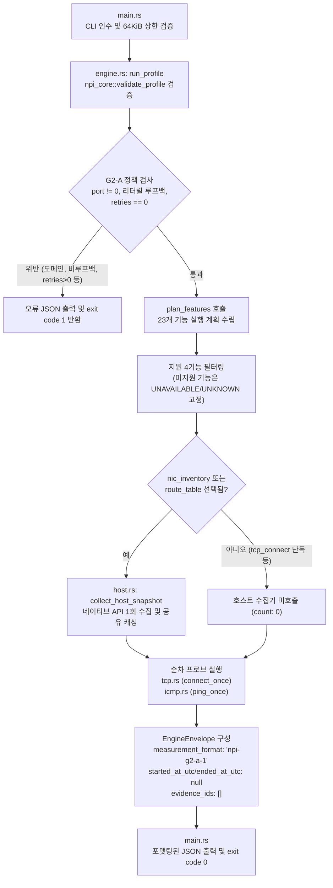

# G2-A 개발자 가이드 — 단일 대상 기초 측정 엔진 및 CLI

## 1. 개요 및 범위

본 문서는 Windows 네트워크 경로 진단 하네스의 **G2-A 단계(단일 루프백 대상의 기초 TCP/ICMP/NIC/route 측정)** 아키텍처, 실행 흐름, 판정 분류 체계 및 검증 명령을 안내합니다.

> [!IMPORTANT]
> - **G2-A 한정 범위**: 본 단계는 소유한 단일 리터럴 루프백(`127.0.0.1`, `::1`) 대상의 실제 측정과 로컬 읽기 전용 호스트 네트워크 정보 수집만을 다룹니다.
> - **전체 제품 미완료**: 전체 G2 수용 검증, 실사용 완제품, 네이티브 UI 연동, 패킷 캡처, PDF/ZIP 내보내기, Windows EXE/MSI 설치 패키지, 운영망/Windows 11/Windows Server 지원, 성능 예산 인증은 **완료되지 않았습니다**.
> - **DNS 모듈 상태**: DNS 해석 모듈은 별도 격리 환경(`.harness/qa/g2dns`)에서 단위 시험(passed 67, ignored 1)을 통과했으나, [`main.rs`](file:///E:/harnes/network-path-inspector/.worktrees/g2guide/crates/npi-probes/src/main.rs) 및 [`engine.rs`](file:///E:/harnes/network-path-inspector/.worktrees/g2guide/crates/npi-probes/src/engine.rs)와의 런타임 연결은 아직 검증되지 않았으며 이후 별도 작업자(worker)가 진행 중입니다. 임의의 새로운 DNS 명령이나 CLI 플래그를 발명하거나 사용해서는 안 됩니다.
> - **일회성 도구 경계**: `tools/integrate_g01.py`와 `tools/revise_*.py`는 과거 개발 이력 보존용 일회성 스크립트이며 일반 빌드나 진단 애플리케이션 실행 도구가 아닙니다.

---

## 2. 코드 구조 및 실행 흐름

실제 소스 코드를 읽고 이해하기 위한 권장 파일 읽기 순서와 내부 실행 파이프라인은 다음과 같습니다.

### 파일 읽기 순서
1. [`crates/npi-probes/src/main.rs`](file:///E:/harnes/network-path-inspector/.worktrees/g2guide/crates/npi-probes/src/main.rs): CLI 엔트리포인트, 프로필 파일 입력 검증, Tokio 런타임 초기화.
2. [`crates/npi-probes/src/engine.rs`](file:///E:/harnes/network-path-inspector/.worktrees/g2guide/crates/npi-probes/src/engine.rs): 프로필 유효성 검증, 루프백 정책 적용, 실행 계획 수립, 수집기 순차 디스패치 및 중간 엔벨로프 생성.
3. [`crates/npi-probes/src/host.rs`](file:///E:/harnes/network-path-inspector/.worktrees/g2guide/crates/npi-probes/src/host.rs): Windows 네이티브 읽기 전용 IP Helper API를 통한 1회 호스트 네트워크 스냅샷 수집.
4. [`crates/npi-probes/src/tcp.rs`](file:///E:/harnes/network-path-inspector/.worktrees/g2guide/crates/npi-probes/src/tcp.rs): Tokio 기반 비동기 TCP 3-way 핸드셰이크 측정 (애플리케이션 바이트 미전송).
5. [`crates/npi-probes/src/icmp.rs`](file:///E:/harnes/network-path-inspector/.worktrees/g2guide/crates/npi-probes/src/icmp.rs): Windows ICMP 동기 시스템 콜 에코 측정 (타임아웃 상한 2000ms).
6. [`crates/npi-probes/src/lib.rs`](file:///E:/harnes/network-path-inspector/.worktrees/g2guide/crates/npi-probes/src/lib.rs): 크레이트 모듈 노출.



### 상세 실행 단계
1. **진입점 및 입력 제약 검증 ([`main.rs`](file:///E:/harnes/network-path-inspector/.worktrees/g2guide/crates/npi-probes/src/main.rs))**:
   - `npi-probes <profile.json>` 단일 인수만 허용하며 비루프백 우회 플래그를 일절 제공하지 않습니다.
   - 프로필 파일 크기는 최대 64KiB(`MAX_PROFILE_BYTES = 64 * 1024`)로 제한되어 메모리 오버런을 방지합니다.
   - 단일 스레드(`new_current_thread`) Tokio 런타임을 구성하여 비동기 프로브를 통제합니다.
2. **프로필 검증 및 계획 수립 ([`engine.rs`](file:///E:/harnes/network-path-inspector/.worktrees/g2guide/crates/npi-probes/src/engine.rs))**:
   - [`validate_profile`](file:///E:/harnes/network-path-inspector/.worktrees/g2guide/crates/npi-core/src/validation.rs)로 G1 공통 프로필 스키마를 검증합니다.
   - `target.port == 0`은 즉시 거부됩니다.
   - `target.host`는 리터럴 IP(`IpAddr`)로만 파싱되며, 도메인 이름 입력 시 백그라운드 해석을 시도하지 않고 즉시 거부(`DNS_ERROR` / `UNAVAILABLE`)합니다.
   - `is_unspecified()`, `is_multicast()`, `!is_loopback()` 검사를 통해 오직 리터럴 루프백(`127.0.0.1`, `::1`) 대상만 허용하며 비루프백 대상은 즉시 거부합니다.
   - `limits.retries > 0` 요청은 G2-A 단계에서 지원하지 않으므로 즉시 거부합니다 (요청을 묵인하거나 누락하지 않음).
   - 공통 레지스트리와 DAG 계획기([`plan_features`](file:///E:/harnes/network-path-inspector/.worktrees/g2guide/crates/npi-core/src/planning.rs))를 호출하여 23개 전체 기능의 초기 결과를 준비합니다.
3. **선택 4기능 필터링 및 미구현 기능 처리**:
   - G2-A 단계에서 실제 측정을 지원하는 기능(`SUPPORTED_G2A_FEATURES`)은 `tcp_connect`, `icmp_ping`, `nic_inventory`, `route_table` 4개입니다.
   - 프로필에서 선택되지 않은 기능은 G1 계획에 따라 `SKIPPED_BY_USER` 및 null 타이밍을 유지합니다.
   - 선택되었으나 G2-A에서 구현되지 않은 기능은 `UNAVAILABLE` (`UNKNOWN`) 상태와 빈 증거 배열(`evidence_ids: []`)로 고정하며 가짜 `PASS`를 반환하지 않습니다.
4. **호스트 네트워크 스냅샷 1회 공유 ([`host.rs`](file:///E:/harnes/network-path-inspector/.worktrees/g2guide/crates/npi-probes/src/host.rs))**:
   - `nic_inventory` 또는 `route_table` 중 하나 이상이 선택된 경우에만 [`collect_host_snapshot`](file:///E:/harnes/network-path-inspector/.worktrees/g2guide/crates/npi-probes/src/host.rs)을 전체 실행 중 정확히 1회 호출하여 결과를 공유합니다.
   - `tcp_connect`만 단독 선택된 경우에는 호스트 스냅샷 수집기를 호출하지 않습니다 (`collector_counts.host_network_snapshot == 0`).
5. **순차 프로브 실행 및 취소 처리**:
   - 각 수집기 호출 전후에 취소 플래그(`cancelled`)를 검사합니다. 취소 신호 수신 시 잔여 기능은 프로브를 보내지 않고 `CANCELLED` (`UNKNOWN`)로 기록합니다.
   - [`connect_once`](file:///E:/harnes/network-path-inspector/.worktrees/g2guide/crates/npi-probes/src/tcp.rs): 프로필의 `limits.tcp_timeout_ms`를 온전히 적용하여 비동기 소켓 연결을 시도합니다. 연결 성공 시 즉시 소켓을 드롭하며 애플리케이션 바이트를 송수신하지 않습니다 (`application_bytes_sent = 0`).
   - [`ping_once`](file:///E:/harnes/network-path-inspector/.worktrees/g2guide/crates/npi-probes/src/icmp.rs): 동기 ICMP 호출의 스레드 블로킹 방지를 위해 프로필 타임아웃에 `clamp(1, 2000)`를 적용한 상한(최대 2000ms)을 사용하며, 제품 TCP 타임아웃 자체는 변경하지 않습니다.
6. **중간 엔벨로프 반환 ([`EngineEnvelope`](file:///E:/harnes/network-path-inspector/.worktrees/g2guide/crates/npi-probes/src/engine.rs#L50-L61))**:
   - 실행 결과는 `npi-g2-a-1` 포맷의 독립 JSON 엔벨로프로 직렬화되어 반환됩니다.

---

## 3. 중간 엔벨로프 성격 및 투명성 공개

[`EngineEnvelope`](file:///E:/harnes/network-path-inspector/.worktrees/g2guide/crates/npi-probes/src/engine.rs#L50-L61)는 개발자 CLI 검증을 위한 중간 포맷입니다:

> [!WARNING]
> 1. **정규 Session 1.1 및 영구 증거 아님**: 본 엔벨로프(`measurement_format: "npi-g2-a-1"`)는 정규 G1 `Session` 1.1 문서나 최종 진단 보고서가 아닙니다.
> 2. **UTC 시각 미동기화 (null 유지)**: 실제 UTC 시계 동기화와 정규 세션 DTO 통합은 후속 단계 대상이므로, 가짜 시계를 조작하지 않고 `started_at_utc`와 `ended_at_utc`는 항상 `null`로 유지합니다. 실행 시간은 실제 프로브가 소요한 `Instant` 기반 경과 시간(`duration_ms`)으로만 기록됩니다.
> 3. **디스크 아카이브 부재 (`evidence_ids: []`)**: 수집된 원시 DTO는 엔벨로프의 `measurements` 맵에 메모리 형태로만 포함되며, 디스크에 영구 증거 파일로 저장되지 않았으므로 각 기능 결과의 `evidence_ids`는 항상 빈 배열(`[]`)로 유지합니다.

---

## 4. 진단 판정 원칙 및 상태 분류

관찰된 시스템 측정값과 추론을 명확히 구분해야 합니다.

### 측정 / 추론 / 미확인 구분
- **OS 오류 10061 (`WSAECONNREFUSED`)**:
  - 대상 포트에서 연결을 수락하지 않았다는 **OS 로컬 소켓 API의 오류 관찰값**입니다.
  - 별도의 패킷 캡처 증거가 없으므로 네트워크 상에서 실제 `RST` 패킷이 관찰되었는지, 또는 중간 방화벽 등 특정 보안 장비에 의해 차단되었는지를 단정해서는 안 됩니다.
- **TCP 연결 성공 (`CONNECTED` / `PASS`)**:
  - 커널 수준의 TCP 3-way 핸드셰이크가 완료되었다는 관찰값입니다.
  - 애플리케이션 바이트를 일절 전송하지 않으므로(`application_bytes_sent == 0`), 대상 서비스(예: Oracle DB 리스너 등)의 계정 인증이나 프로토콜 수준 정상 작동을 증명하지 않습니다.
- **호스트 스냅샷의 `selected_route`**:
  - 로컬 OS 라우팅 테이블 조회(`GetBestRoute2`)의 선택 결과일 뿐이며, 원격 목적지까지의 실제 경로 통달성 증거가 아닙니다.
- **ICMP 무응답 및 타임아웃 (`WARN`)**:
  - 시스템 또는 네트워크의 ICMP 에코 비활성화 정책일 수 있으므로, TCP 포트 실패나 특정 장비 차단으로 단정하지 않고 `WARN`으로 기록합니다.

### 기능 결과 상태(`status`) 및 분류(`classification`) 체계

| 상황 | `status` | `classification` | 판정 기준 및 설명 |
| :--- | :--- | :--- | :--- |
| **정상 성공** | `PASS` | `OBSERVED` | TCP 핸드셰이크 성공(`CONNECTED`), ICMP 응답(`REPLY`), 로컬 NIC/라우트 정상 수집. |
| **부분 호스트 오류** | `WARN` | `OBSERVED` | 어댑터/라우트 필수 데이터는 관찰되었으나 호스트 스냅샷 수집 오류(`errors != []`)가 동반된 경우. |
| **ICMP 지연/미수신** | `WARN` | `OBSERVED` | ICMP 타임아웃 또는 도달 불가 (TCP 서비스 실패로 단정하지 않음). |
| **소켓 거부/타임아웃** | `FAIL` | `OBSERVED` | OS 수준의 연결 거부(`REFUSED` / 10061) 또는 연결 타임아웃(`TIMED_OUT`). |
| **필수 데이터 누락** | `ERROR` | `UNKNOWN` | 어댑터 목록 또는 라우팅 정보가 비어 있거나 파싱할 수 없는 경우. |
| **로컬 소켓 오류** | `ERROR` | `OBSERVED` / `UNKNOWN` | 포트 0, 잘못된 주소 등 로컬 소켓 호출 오류(`LOCAL_ERROR`). |
| **미지원 기능/환경** | `UNAVAILABLE` | `UNKNOWN` | G2-A 미구현 기능이 선택되었거나 비 Windows 환경에서 호스트 수집기 호출 시. |
| **사용자 미선택** | `SKIPPED_BY_USER` | `UNKNOWN` (null) | 프로필에서 선택하지 않은 기능 (G1 계획 상태 보존). |
| **실행 취소** | `CANCELLED` | `UNKNOWN` | 취소 신호가 감지되어 프로브를 호출하지 않고 중단된 경우. |

---

## 5. 실제 검증 및 실행 명령

코드 베이스와 체크포인트에서 확인된 실제 명령만을 안내합니다.

### 오프라인 품질 및 정적 검증
프로젝트 루트(`E:\harnes\network-path-inspector`)에서 실행:
```text
cargo fmt --check
cargo clippy --offline --workspace --all-targets -- -D warnings
cargo test --offline --workspace --all-targets
```

### 실제 루프백 격리 통합 시험 (부모 명시 실행)
소켓을 생성하는 실제 루프백 시험은 일반 오프라인 게이트에서 실행되지 않도록 `#[ignore]` 처리되어 있습니다. 로컬 루프백 검증 시 아래 명령으로 명시 실행합니다:
```text
cargo test --offline -p npi-probes --tests -- --ignored --test-threads=1 --nocapture
```

### 개발자 CLI 직접 실행
```text
cargo run --offline -p npi-probes -- <profile.json>
```

> [!NOTE]
> **종료 코드(`exit code`)의 의미**:
> - `ExitCode::SUCCESS (0)`: 프로필 검증을 통과하고 측정을 정상적으로 수행하여 엔벨로프 JSON 출력을 완료했음을 의미합니다. **진단 결과가 PASS이거나 전체 제품이 완료되었음을 의미하지 않습니다** (예: 대상 포트가 닫혀 TCP `FAIL`이 발생해도 측정 파이프라인이 정상 종료되면 `exit 0`을 반환함).
> - `ExitCode::from(1)`: 프로필 파일 부재, 64KiB 초과, JSON 구문 오류, 포트 0, 비루프백 대상 위반, 도메인 이름 입력, `retries > 0` 등 입력 정책 위반 시 반환됩니다.

---

## 6. 프로필 작성 안내 및 완전한 JSON 예시

### 기존 G1 Fixture 실행 주의
`fixtures/g1/valid_profile_quick.json`은 대상 호스트가 `"db-internal.corp.example"`(도메인 이름)로 설정되어 있습니다. G2-A 런타임은 도메인 이름을 받으면 백그라운드 해석을 수행하지 않고 `DNS_ERROR / UNAVAILABLE`로 즉시 거부하므로, **기존 fixture 파일을 그대로 `npi-probes` CLI에 전달해서는 안 됩니다**.

### 루프백 프로필 작성 규칙
- `fixtures/g1/valid_profile_quick.json`의 모든 필수 필드와 limits 규격을 온전히 유지해야 합니다.
- `target.host`는 반드시 리터럴 루프백 주소(`"127.0.0.1"` 또는 `"::1"`)여야 합니다.
- `target.port`는 사용자가 로컬에서 소유/리스닝 중인 임시 서버 포트 1개(예: `8080`)여야 합니다.
- `selected_features`는 G2-A 지원 기능 중 원하는 기능(예: `["tcp_connect"]` 등)을 선택합니다.
- `retries`는 반드시 `0`이어야 합니다.
- `capture_approved`는 `false`로 설정합니다.

### 테스트용 완전한 프로필 JSON 예시
임의의 존재하지 않는 가상 파일 경로를 참조하지 말고, 아래 JSON 전문을 복사하여 로컬 임시 파일(예: `profile_loopback_test.json`)로 저장한 후 CLI에 전달하십시오:

```json
{
  "schema_version": "1.1",
  "profile_id": "quick-loopback-tcp",
  "label": "G2-A 루프백 단일 대상 TCP 측정",
  "mode": "standalone",
  "selected_features": [
    "tcp_connect"
  ],
  "capture_approved": false,
  "target": {
    "host": "127.0.0.1",
    "port": 8080,
    "protocol": "TCP"
  },
  "limits": {
    "tcp_timeout_ms": 5000,
    "max_hops": 30,
    "retries": 0,
    "max_concurrent_tcp": 4,
    "capture_duration_secs": 30,
    "capture_max_bytes": 52428800,
    "log_retention_days": 30,
    "ui_updates_per_second": 4
  }
}
```

4개 지원 기능을 모두 측정하려면 `selected_features`를 다음과 같이 설정합니다:
```json
"selected_features": [
  "tcp_connect",
  "icmp_ping",
  "nic_inventory",
  "route_table"
]
```

---

## 7. 체크포인트 실측치

[`.harness/references/g2a-checkpoint.json`](file:///E:/harnes/network-path-inspector/.worktrees/g2guide/.harness/references/g2a-checkpoint.json)에 기록된 실제 로컬 검증 결과는 다음과 같습니다. 범주가 서로 다른 시험 수를 단순 합산하거나 전체 제품 완료율(%)로 표기하지 않습니다:

- **오프라인 단위 테스트** (`cargo test --offline --workspace --all-targets`): 130 passed, 0 failed, 13 ignored
- **명시적 실제 루프백 테스트** (`cargo test --offline -p npi-probes --tests -- --ignored`): 13 passed, 0 failed, 0 ignored
- **CLI 루프백 시나리오 검증** (`npi-probes.exe` 직접 실행 10종): 10 executed, 10 passed, 0 failed
- **DNS 모듈 격리 단위 테스트** (`.harness/qa/g2dns`): 67 passed, 0 failed, 1 ignored
- **프로젝트 하네스 회귀 테스트** (`tools/tests`): 31 passed

---

## 8. 안전 수칙 및 환경 보호

모든 개발 및 테스트 단계에서 아래 안전 수칙을 엄격히 준수해야 합니다:
- **운영망 및 임의 대상 접속 금지**: 실제 진단 시험은 시험자가 생성하고 소유한 `127.0.0.1` 및 `::1` 루프백 단일 대상에만 허용됩니다. 예시 사설망(`192.168.*` 등)이나 운영 서버에 접속하거나 포트 스캔을 수행하지 않습니다.
- **OS 설정 및 드라이버 불변**: 방화벽 규칙, 라우팅 테이블, 레지스트리, 인증서 저장소를 변경하지 않습니다. Npcap이나 기타 시스템 드라이버/서비스를 설치하지 않으며 관리자 권한 상승을 요구하지 않습니다.
- **데이터베이스 인증 금지**: 운영 DB 접속 인증 및 SQL 질의를 일절 수행하지 않습니다.
- **자격 증명 보호**: 계정, 토큰, 비밀번호를 파일에 기록하거나 읽지 않습니다.
