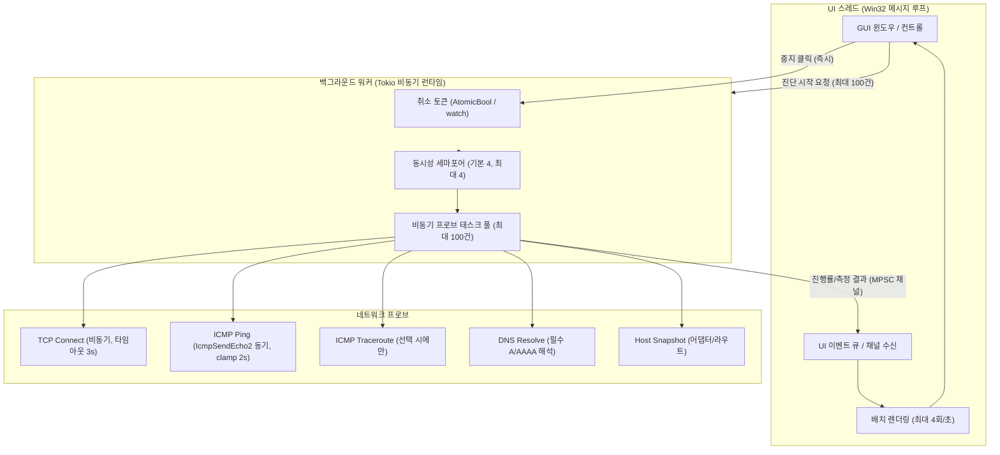

# Network Quick Check — 시스템 아키텍처 설계서 (QG0)

- 문서 버전: 0.1.0 (QG0 초안)
- 작성일: 2026-10-21
- 상태: QG0 설계 단계 (구현 및 실행 검증 전)
- 관련 PRD: [Network_Path_Inspector_Harness_PRD_v1.2.md](file:///E:/harnes/network-path-inspector/docs/requirements/Network_Path_Inspector_Harness_PRD_v1.2.md) Part B
- 인터페이스 계약: [.harness/references/qg1-contract.json](file:///E:/harnes/network-path-inspector/.harness/references/qg1-contract.json)

---

## 1. 개요 및 제품 포지셔닝

Network Quick Check(Part B)는 동일 프로젝트(`E:/harnes/network-path-inspector`) 내에서 정밀 패킷 분석 도구인 Network Path Inspector(Part A)와 공존하며, 설치 절차나 외부 런타임 의존성 없이 단일 실행 파일(EXE)만으로 PC 한 대에서 대상 IP:Port의 기본 통신 가능 여부를 즉시 검증하는 경량 네이티브 도구입니다.

### 1.1 두 제품의 비교 아키텍처

| 구분 | Network Path Inspector (Part A) | Network Quick Check (Part B) |
|---|---|---|
| 주요 목적 | 양방향 패킷 증빙, 오프라인 병합, 정밀 장애 분석 | 단독 PC에서 즉각적인 IP:Port 통신 확인 |
| 배포 형태 | 설치형 / 포터블, 필요 시 Agent 및 Npcap 드라이버 | **무설치 네이티브 단일 EXE** (복사 실행) |
| GUI 계층 | Tauri + React (웹뷰 런타임 의존) | **Rust 네이티브 Windows GUI** (`windows-sys` Win32 API 우선) |
| 실행 권한 | 패킷 캡처 및 저수준 기능 시 관리자 권한 요청 가능 | **일반 사용자 권한 (`asInvoker`) 전용** (UAC 상승 없음) |
| 외부 의존성 | Npcap, SQLite, PDF 렌더러, WebView2 런타임 | **Npcap, DB, 웹뷰, PDF, 외부 런타임 의존성 0건** |
| 진단 범위 | TCP, ICMP, Traceroute, 패킷 캡처, 양방향 비교, PDF 보고서 | TCP Connect, Ping, Traceroute, DNS 조회, 로컬 정보 |
| 통신 모드 | 단독 모드 + 양방향(Agent) 모드, 오프라인 병합 | **단독 모드 전용** (서버 Agent 및 중계 통신 없음) |

> [!IMPORTANT]
> Network Quick Check는 **운영체제 정책(방화벽/라우트/레지스트리/인증서)을 일체 변경하지 않는 비파괴적 읽기·연결 시도 도구**입니다. 또한 단독 진단 특성상 대상 서버에서의 수신 여부나 SYN/RST 패킷의 물리적 관찰을 증명할 수 없으며, 연결 실패를 방화벽 차단으로 단정하지 않습니다.

---

## 2. 워크스페이스 및 모듈 구조

두 제품은 동일한 Cargo 워크스페이스를 공유하며, 중복 코드 작성 없이 공통 진단 엔진을 재사용합니다.

### 2.1 워크스페이스 디렉터리 레이아웃

```text
E:/harnes/network-path-inspector/
├── Cargo.toml                          # 워크스페이스 루트 매니페스트
├── contracts/
│   └── g1-interface-contract.json      # Part A 정규 계약 (Session 1.1)
├── .harness/references/
│   └── qg1-contract.json               # Part B 정규 계약 (Frozen, schema 1.0)
├── crates/
│   ├── npi-core/                       # 기존 Part A 코어 (모델, 세션, 오류 분류)
│   ├── npi-probes/                     # 기존 Part A 프로브 (TCP, ICMP, 호스트 스냅샷)
│   └── network-core/                   # [예정/Planned] Part B용 공용 facade 라이브러리
├── apps/
│   ├── network-inspector/              # [예정/Planned] 기존 Tauri 기반 Inspector 앱
│   └── network-quick-check/            # [예정/Planned] 신규 네이티브 Win32 GUI 단일 EXE 앱
└── docs/
    ├── requirements/
    └── quick-check/                    # Part B QG0~QG7 설계 및 품질 관리 문서
```

### 2.2 공용 Facade 계층 (`crates/network-core` [예정/Planned])

- **코드 재사용 원칙**: root의 기존 crate 이름(`npi-core`, `npi-probes`)을 광범위하게 변경하지 않고, 신규 `crates/network-core` facade 라이브러리가 기존 `npi-core`와 `npi-probes`의 검증된 구현을 직접 래핑·재사용합니다.
- **코드 중복 복사 금지**: TCP 연결, ICMP 핑, 호스트 네트워크 정보 수집 로직을 별도로 복사하여 `apps/network-quick-check` 내에 중복 구현하는 것을 엄격히 금지합니다.
- **물리적 분리 상태 명시**: 향후 Network Path Inspector 역시 공용 `network-core`를 사용하도록 정렬될 예정이나, **현재 시점에서는 기존 Inspector의 물리적 추출 및 새 facade 전환이 아직 수행되지 않은 상태(Not yet migrated/extracted)**임을 명확히 합니다. 기존 Inspector 동작 및 테스트 코드는 1바이트도 수정하지 않습니다.

---

## 3. 의존성 격리 및 단일 EXE 빌드 정책

Quick Check의 최우선 가치는 **어떠한 사전 설치 없이 깨끗한 Windows PC에서 즉시 실행되는 단일 네이티브 바이너리**입니다.

### 3.1 런타임 및 라이브러리 배제 원칙

Quick Check 바이너리 및 공용 facade에는 다음 의존성이 전이(transitive dependency)되지 않도록 철저히 차단합니다:
1. **브라우저 엔진 및 웹뷰**: WebView2, Edge Chromium, Tauri 런타임 배제.
2. **패킷 캡처 라이브러리**: Npcap SDK, `pcap`, WinPcap, Raw Socket 캡처 배제.
3. **에이전트 및 원격 통신**: gRPC, 양방향 동기화 프로토콜, 관리 서버 통신 배제.
4. **무거운 문서 렌더러**: PDF 생성 엔진(PrintToPDF, headless chrome 등) 배제.
5. **데이터베이스 엔진**: SQLite, rusqlite, 로컬 저장 DB 엔진 배제.

### 3.2 C 런타임(CRT) 정적 링크 및 OS 시스템 DLL 경계

- **MSVC CRT 정적 링크 (`+crt-static`, `/MT`) 검토**:
  - 타깃 시스템에 `VCRUNTIME140.dll` 또는 `MSVCP140.dll` 재배포 패키지가 설치되어 있지 않아도 실행될 수 있도록 MSVC CRT 정적 링크를 검토합니다.
  - **주의**: CRT 정적 링크는 C/C++ 런타임 종속성을 바이너리에 포함한다는 의미이며, **Windows OS 시스템 DLL 의존성이 0개라는 의미가 아닙니다**.
  - 필수 허용 OS 시스템 DLL: `kernel32.dll`, `user32.dll`, `gdi32.dll`, `ws2_32.dll`, `iphlpapi.dll` 등 Windows 표준 서브시스템 DLL.
- **단일 EXE 검증 절차**:
  - 개발 완료 후 Release 빌드 산출물에 대해 `dumpbin /dependents` 또는 PE Import 테이블 분석을 수행하여 허용되지 않은 외부 DLL 참조가 없는지 확인합니다.
  - 최신 런타임이 전혀 설치되지 않은 깨끗한 Windows 가상 머신(VM) 환경에서의 실행 검증을 QG6 수용 기준으로 설정합니다.

---

## 4. 동시성, 비동기 스레딩 및 UI 비차단 설계

네트워크 진단 도구는 수 초 이상의 네트워크 타임아웃이나 대기 시간이 발생하므로, UI 응답성이 절대 저해되어서는 안 됩니다.



### 4.1 메인 스레드 네트워크 I/O 제로 원칙

- **UI 메인 스레드**: Win32 메시지 디스패치(`GetMessage`/`DispatchMessage`) 및 컨트롤 렌더링만 전담하며, 소켓 생성, 주소 해석, 패킷 전송 등 네트워크 I/O를 0건으로 유지합니다.
- **백그라운드 워커**: 전용 비동기 런타임(Tokio) 또는 워커 스레드 풀에서 진단 작업을 스케줄링합니다.
- **결과 통신**: UI 스레드와 워커 스레드는 비차단 통신 채널(MPSC)로 결합되며, UI는 초당 최대 4회(250ms 간격) 배치로 변경사항을 화면에 반영하여 과도한 다시 그리기(redraw)로 인한 프리징을 방지합니다.

### 4.2 중지 및 취소 지연 시간의 실측 전 설계 목표와 실제 제약

- **자원 정리 3초 목표**: PRD에 명시된 "취소 후 3초 이내 자원 정리"는 **실측 전 설계 목표(Design Target)**이며, 이를 실제 검증 없이 달성되었다고 간주할 수 없습니다.
- **프로브별 취소 동작의 물리적 한계 구분**:
  1. **비동기 TCP (`tcp_connect`)**: `tokio::select!` 편향 분기 및 10~20ms 폴링을 통해 취소 신호 수신 즉시 퓨처를 drop하고 소켓을 닫으므로 수십 밀리초 이내 즉각 취소가 가능합니다.
  2. **동기 Win32 ICMP (`icmp_ping`, `IcmpSendEcho2`)**: Windows 네이티브 `IcmpSendEcho2` API는 블로킹 동기 호출로 동작합니다. 취소 플래그가 설정되어도 이미 API 내부에서 대기 중인 호출은 시스템 타임아웃(설계상 최대 2000ms로 clamp 제한)까지 블로킹될 수 있습니다.
  3. **자식 프로세스/Traceroute (`icmp_traceroute`)**: 자식 프로세스나 반복 홉 프로브를 실행 중인 경우 취소 시 프로세스 kill 및 핸들 반환이 완료될 때까지 지연이 발생할 수 있습니다.
- 따라서 설계서에서는 "즉각적인 취소"라는 이상적 주장을 지양하고, **소켓 및 API 레벨의 취소 레이턴시 한계(최대 2초 블로킹 가능성)를 명확히 문서화**합니다.

---

## 5. 입력 검증, 스캔 금지 및 기본 제안값 정책

Quick Check는 관리되지 않은 무분별한 네트워크 트래픽을 유발하지 않도록 엄격한 입력 상한과 안전한 기본값을 강제합니다.

### 5.1 계약 제안값 (`limits_proposal`)

[.harness/references/qg1-contract.json](file:///E:/harnes/network-path-inspector/.harness/references/qg1-contract.json)에 명시된 제안값을 기본 정책으로 채택합니다:
- **`max_targets` (최대 대상 수)**: **최대 100건**. 클립보드 붙여넣기나 수동 추가 시 100건을 초과하는 입력은 소켓 생성 전에 거부 또는 경고합니다.
- **`concurrency` (동시성 제한)**: **기본값 4, 하드 상한(Cap) 4**. 시스템 자원 고갈 및 대상 네트워크 폭주를 막기 위해 동시 프로브 수를 최대 4개로 고정합니다. 무제한 병렬 실행은 절대 허용하지 않습니다.
- **`default_tcp_timeout_ms` (기본 TCP 타임아웃)**: **3,000ms (3초)**.
- **`default_features` (기본 활성 기능)**: **`tcp_connect` 및 `icmp_ping` 2개 기능만 기본 활성화**. 고비용의 Traceroute는 기본적으로 비활성화(OFF)합니다.

### 5.2 IP 대역 및 포트 범위 확장 스캔 0건 원칙

- 사용자가 명시적으로 입력한 대상(IP:Port 또는 도메인:Port)에 대해서만 단일 연결을 시도합니다.
- 서브넷 전체 탐색(예: `192.168.1.0/24`), IP 대역 스캔(CIDR expansion), 포트 범위 스캔(예: `1~1024`) 기능은 **0건으로 배제**하며 관련 코드를 일체 작성하지 않습니다.

### 5.3 도메인 해석과 기능별 미선택 원칙

- **의도된 도메인 필수 해석**: 사용자가 목적지로 호스트명/도메인(예: `db.internal.corp`)을 입력한 경우, TCP 소켓 연결을 수립하기 위해 시스템 기본 리졸버를 통한 대상 IP(A/AAAA) 확인이 반드시 선행되어야 합니다.
- **상세 DNS 검사(`dns_lookup`)와의 분리**:
  - `dns_lookup` 기능 체크박스를 선택하지 않은 경우: 상세 DNS 레코드 질의, 다중 IP 해석 목록화, 질의 지연시간 수집 등은 일체 수행하지 않습니다 (기능별 미선택 0 원칙). 단지 TCP 연결에 필요한 단일 IP만 해석하여 사용합니다.
  - `dns_lookup` 기능 체크박스를 선택한 경우: 도메인에 매핑된 전체 IP 목록, 해석 시간, 정방향 조회 결과를 정규 측정값으로 기록합니다.
- **OS 리졸버 헬퍼의 현재 상태 한계**:
  - 현재 `npi-probes`에 존재하는 로컬 주소 및 IP 검증 로직은 Inspector 개발 CLI의 루프백(`localhost`, `127.0.0.1`) 전용 제한 상태입니다.
  - 따라서 **"생산용 DNS/비루프백 리졸버 구현이 이미 완료되었다"고 주장할 수 없으며**, 이는 QG2 단계에서 안전하게 구현해야 할 미완료 과제로 규정합니다.

---

## 6. 데이터 계약, 상태 분류 및 구버전 호환

Part B Network Quick Check는 고정된 `qg1-contract.json` (schema 1.0) 계약을 단일 진실 공급원으로 준수합니다.

### 6.1 정규 데이터 스키마 (schema 1.0)

Quick Check의 모든 검사 결과는 다음 14개 정규 필드를 포함하는 단일 레코드로 정규화됩니다:

```json
{
  "schema_version": "1.0",
  "product": "network-quick-check",
  "session_id": "550e8400-e29b-41d4-a716-446655440000",
  "timestamp_iso8601": "2026-10-21T02:30:00Z",
  "source_host": "CLIENT-PC01",
  "target_host": "192.168.10.100",
  "resolved_ip": "192.168.10.100",
  "target_port": 1526,
  "feature": "tcp_connect",
  "status": "FAIL",
  "elapsed_ms": 3001,
  "os_error_code": 10060,
  "details": {
    "outcome": "TIMED_OUT",
    "raw_measurement": {
      "application_bytes_sent": 0,
      "error_message": "지정된 제한 시간(3000ms) 내에 TCP 연결이 완료되지 않아 시간 초과되었습니다."
    },
    "limitations": [
      "OS 소켓 API 수준의 관찰 결과이며, 패킷 캡처 근거 없이 실제 SYN/RST 패킷 송수신이나 중간 차단 장비를 단정하지 않습니다."
    ]
  },
  "evidence_level": "OBSERVED"
}
```

- **Null 허용 필드**: `timestamp_iso8601`, `source_host`, `resolved_ip`, `elapsed_ms`, `os_error_code` (실제 관찰되지 않은 값은 허위 생성하지 않고 반드시 `null` 기록).
- **허용 상태(`status`)**: `PASS`, `FAIL`, `WARN`, `SKIPPED`, `UNKNOWN`.
- **허용 증거 수준(`evidence_level`)**: `OBSERVED`, `INFERRED`, `UNKNOWN`.

### 6.2 TCP 상태 매핑 규칙 (`tcp_status_mapping`)

Part A 코어(`npi-core`)의 `TcpOutcome`을 Part B 계약(`qg1-contract.json`)으로 변환할 때 다음 규칙을 철저히 적용합니다:

| `TcpOutcome` | 변환 `status` | 변환 `evidence_level` | 설명 및 세부 보존 |
|---|---|---|---|
| `CONNECTED` | `PASS` | `OBSERVED` | 핸드셰이크 성공 (애플리케이션 검증 아님) |
| `REFUSED` | `FAIL` | `OBSERVED` | 소켓 거부 오류코드(10061) 관찰 |
| `RESET` | `FAIL` | `OBSERVED` | 연결 리셋 오류코드(10054) 관찰 |
| `TIMED_OUT` | `FAIL` | `OBSERVED` | 타임아웃 오류코드(10060) 또는 타임아웃 감지 |
| `UNREACHABLE` | `FAIL` | `OBSERVED` | 호스트/망 도달 불가 오류코드(10051/10065) |
| `DNS_ERROR` | `FAIL` | `OBSERVED` | 주소 변환 실패(11001~11004) |
| `LOCAL_ERROR` | **`UNKNOWN`** | **`OBSERVED`** | 로컬 소켓/권한 오류는 원격 판정 불가이므로 `UNKNOWN` |
| `CANCELLED` | **`UNKNOWN`** | **`UNKNOWN`** | 취소된 검사는 원격 및 관찰 상태 모두 `UNKNOWN` |
| `unrecognized` | **`UNKNOWN`** | **`UNKNOWN`** | 미인식 결과는 안전하게 `UNKNOWN`으로 격리 |

> [!NOTE]
> `LOCAL_ERROR`와 `CANCELLED`의 경우 원격 네트워크 상태를 알 수 없으므로 `status`를 `FAIL`로 위장하지 않고 `UNKNOWN`으로 기록합니다. 이때 소켓 계층에서 발생한 원본 OS 오류 코드와 에러 메시지는 `details` 객체 내에 완전하게 보존합니다.

### 6.3 Part A Session 1.1과의 구분 및 추후 JSON Adapter

- Quick Check는 자체적으로 경량화된 단일 결과 레코드 구조를 사용하며, 복잡한 계층 구조인 Part A `Session 1.1` 문서를 직접 생성하지 않습니다.
- Inspector에서 Quick Check의 결과를 통합 분석할 수 있도록 하는 "공통 JSON Schema 변환 어댑터"는 **P1(후속 요구사항)으로 명시**하며, QG0/QG1의 필수 범위에 포함하지 않습니다.

---

## 7. 결과 저장 및 파일 보안

### 7.1 자동 저장 및 업로드 금지

- 사용자의 명시적인 클릭("결과 복사", "TXT 저장", "CSV 저장")이 없는 한 어떠한 파일도 디스크에 자동 저장되지 않으며, 외부 네트워크로 업로드되지 않습니다.
- 파일 저장은 사용자가 파일 다이얼로그에서 직접 선택한 로컬 폴더에만 수행됩니다.

### 7.2 원자적 파일 쓰기 (Atomic Write)

- 결과 저장 중 프로세스 강제 종료나 시스템 절전 등으로 인해 파일이 손상되는 것을 방지하기 위해 임시 파일(`.tmp`)을 생성하여 전체 내용을 기록한 후, `ReplaceFile` 또는 `fs::rename`을 통해 원자적으로 교체합니다.

### 7.3 CSV 수식 주입(Formula Injection) 방어

- CSV 파일 내보내기 시 대상 주소, 호스트명, 오류 메시지 등의 문자열이 `=`, `+`, `-`, `@`, `\t`, `\r`로 시작하는 경우 Microsoft Excel 등 스프레드시트 프로그램에서 악성 명령어로 실행될 위험이 있습니다.
- 모든 CSV 텍스트 셀은 해당 문자로 시작할 경우 선행 단일 따옴표(`'`)를 붙여 평문 텍스트로 강제 이스케이프합니다.

### 7.4 개인정보 및 사내망 정보 노출 경고

- 진단 결과에는 내부 IP, 내부 도메인 이름, 컴퓨터 이름, 라우팅 게이트웨이 등 내부 네트워크 토폴로지 정보가 포함됩니다.
- 클립보드 복사 또는 파일 저장 시 "내부 사내망 정보가 포함되어 있으므로 외부 반출 시 주의하십시오"라는 안내 메시지를 UI 상에 표시합니다.
- IP 및 호스트명 마스킹 기능은 향후 기본 옵션 제공 여부와 함께 테스트 계획을 수립합니다.
