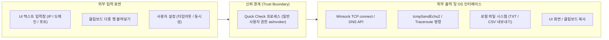

# Network Quick Check — 위협 모델 및 보안 분석서 (QG0)

- 문서 버전: 0.1.0 (QG0 초안)
- 작성일: 2026-10-21
- 상태: QG0 설계 단계 (위협 식별 및 대응책 수립)
- 관련 PRD: [Network_Path_Inspector_Harness_PRD_v1.2.md](file:///E:/harnes/network-path-inspector/docs/requirements/Network_Path_Inspector_Harness_PRD_v1.2.md) Part B Section 18, 21
- 아키텍처: [architecture.md](architecture.md)

---

## 1. 개요 및 보안 설계 원칙

Network Quick Check는 사용자가 전달받은 단일 실행 파일(`NetworkQuickCheck.exe`)을 설치 없이 즉시 실행하여 네트워크 연결성을 진단하는 도구입니다. 운영체제의 시스템 무결성을 해치지 않고, 악의적인 용도로 오용되거나 진단 데이터가 비인가자에게 유출되지 않도록 다음 3대 보안 원칙을 최우선으로 준수합니다:

1. **최소 권한 및 비파괴성 (Zero System Mutation)**: OS 관리자 권한을 요구하지 않으며(`asInvoker`), 방화벽 규칙, 라우팅 테이블, 레지스트리, 드라이버, 서비스, 인증서 저장소를 절대 변경하지 않습니다.
2. **오용 방지 및 무차별 탐색 금지 (Anti-Abuse)**: 서브넷 스캔, 포트 범위 스캔, 브루트포스 공격 도구로 전용되는 것을 원천 차단하며, 사용자 지정 단일 대상에 대해서만 엄격히 제한된 속도로 연결을 시도합니다.
3. **증거 무결성 및 사실/추론 분리 (Fact vs Inference)**: 패킷 캡처 없이 SYN/RST 수신을 단정하거나 연결 실패를 방화벽 차단으로 단정하지 않으며, 관찰된 소켓 API 결과만을 투명하게 기록합니다.

---

## 2. 공격 표면 (Attack Surface) 분석

1. **사용자 입력 및 클립보드**: IP 주소, 도메인 문자열, 포트 번호, 타임아웃 입력 필드 및 대량 행(붙여넣기) 데이터.
2. **OS 네트워크 서브시스템 API**: Winsock 소켓 인터페이스, `IcmpSendEcho2`, 시스템 IP 도우미(`GetAdaptersAddresses`, `GetIpForwardTable2`, `GetBestRoute2`).
3. **로컬 파일 시스템 및 클립보드 출력**: TXT 및 CSV 결과 파일 저장 다이얼로그, 텍스트 클립보드 복사 버퍼.

---

## 3. STRIDE 기반 위협 분석 및 대응책

### 3.1 Spoofing (신원 도용 및 위조)

| 위협 ID | 위협 내용 | 영향도 | 완화 및 대응 설계 |
|---|---|---|---|
| T-SPOOF-01 | 로컬 DNS 변조 또는 DNS 스푸핑으로 인한 잘못된 IP 진단 | 보통 | 연결 시도 전 시스템 리졸버가 반환한 실제 IP(`resolved_ip`)를 결과 레코드에 명시적으로 기록. `OBSERVED` 증거 수준은 "해당 시점 로컬 OS 리졸버가 관찰한 주소"임을 뜻하며 글로벌 진위를 보장하지 않음을 한계로 명시. |
| T-SPOOF-02 | 타사 프로그램 또는 중간 장비의 TCP RST 생성으로 인한 오판 | 높음 | 소켓 `10054(RESET)` 및 `10061(REFUSED)` 수신 시 이를 "RST 패킷 관찰" 또는 "방화벽 장비에 의한 차단"으로 승격하지 않고, "OS 소켓 API 수준의 연결 거부/재설정 관찰"로만 분류(`details.outcome = RESET / REFUSED`). |

### 3.2 Tampering (데이터 변조)

| 위협 ID | 위협 내용 | 영향도 | 완화 및 대응 설계 |
|---|---|---|---|
| T-TAMP-01 | CSV 파일 내보내기 시 수식 주입 (CSV/Formula Injection) 공격 | 높음 | 검사 대상, 오류 메시지, 호스트명 등 CSV 텍스트 필드의 첫 문자가 `=`, `+`, `-`, `@`, `\t`, `\r`로 시작할 경우 선행 단일 따옴표(`'`)를 강제 삽입하여 스프레드시트 실행을 무력화. |
| T-TAMP-02 | 결과 파일 저장 도중 비정상 종료로 인한 파일 손상 | 보통 | 원자적 파일 쓰기(Atomic Write) 적용: 임시 파일(`.tmp`)에 전체 데이터를 완전히 기록하고 flush한 후, 단일 OS 파일 이름 변경(`ReplaceFile` / `fs::rename`) API로 교체. |
| T-TAMP-03 | 진단 결과 상태 위장 (실패/취소/오류를 임의로 왜곡) | 높음 | `CANCELLED`는 `UNKNOWN/UNKNOWN`, `LOCAL_ERROR`는 `UNKNOWN/OBSERVED`로 고정 매핑. 세부 원본 오류 코드(`os_error_code`) 및 원본 메시지를 보존하여 결과를 임의로 PASS나 단순 FAIL로 덮어쓰지 못하도록 제한. |

### 3.3 Repudiation (부인)

| 위협 ID | 위협 내용 | 영향도 | 완화 및 대응 설계 |
|---|---|---|---|
| T-REP-01 | 단독 진단 결과를 근거로 서버 미수신 또는 방화벽 정상성 부인/단정 | 높음 | 단독 PC 측정의 명확한 한계를 UI 및 결과 파일에 강제 포함: "단독 검사는 로컬 PC에서의 관찰 결과이며, 서버 수신 여부나 패킷 송신 완료를 증명하지 않습니다." 단정적 차단 문구 생성 로직 일체 배제. |
| T-REP-02 | 진단 시점 및 환경 차이로 인한 결과 불일치 분쟁 | 보통 | 모든 결과에 ISO-8601 UTC 타임스탬프(`timestamp_iso8601`), 로컬 시간대 오프셋, 프로그램 버전(`0.1.0`), OS 플랫폼 정보를 기록. 미확인 값은 임의 조작하지 않고 `null`로 보존. |

### 3.4 Information Disclosure (정보 노출)

| 위협 ID | 위협 내용 | 영향도 | 완화 및 대응 설계 |
|---|---|---|---|
| T-INFO-01 | 사내망 IP 대역, 내부 호스트명, 라우팅 토폴로지 외부 유출 | 보통 | 1. **자동 전송 배제**: 외부 서버 전송 또는 원격 텔레메트리 전송 로직 0건 (완전한 오프라인 단독 실행). 2. **사용자 경고 다이얼로그**: 클립보드 복사 또는 파일 저장 시 "사내망 정보(내부 IP, 호스트명 등)가 포함되어 있으므로 외부 반출 시 주의하십시오" 안내 팝업/문구 제공. 3. **마스킹 옵션 설계**: 결과 출력 시 IP 뒷자리 또는 내부 도메인을 마스킹하는 정책을 P1 과제로 정의하고 테스트 계획 수립. |
| T-INFO-02 | Oracle/DB 비밀번호 등 자격 증명 유출 | 높음 | 제품 입력 범위에 계정 및 패스워드 필드가 일체 없으며, TCP 3-way 핸드셰이크만 수행하고 어떠한 애플리케이션 페이로드도 송신하지 않음(`application_bytes_sent = 0`). |

### 3.5 Denial of Service (서비스 거부 및 네트워크 부하)

| 위협 ID | 위협 내용 | 영향도 | 완화 및 대응 설계 |
|---|---|---|---|
| T-DOS-01 | 대량 대상 동시 진단으로 인한 로컬 시스템 소켓 고갈 또는 대상 서버 과부하 | 높음 | 1. **대상 상한**: 최대 대상 수 100건(`max_targets: 100`) 엄격 제한. 2. **동시성 하드캡**: 동시 프로브 수를 최대 4개(`max_concurrency: 4`)로 고정하여 무제한 소켓 생성을 물리적으로 차단. 3. **포트/대역 스캔 금지**: CIDR 대역 확장 및 포트 범위 스캔 기능 0건. |
| T-DOS-02 | 장시간 블로킹으로 인한 프로그램 멈춤 및 시스템 자원 점유 | 보통 | 각 프로브별 엄격한 타임아웃 적용 (기본 3,000ms). 취소 버튼 클릭 시 Tokio 비동기 퓨처 즉시 중단. ICMP Win32 동기 호출의 경우에도 2,000ms clamp 상한을 두어 무한 블로킹 방지. |

### 3.6 Elevation of Privilege (권한 상승)

| 위협 ID | 위협 내용 | 영향도 | 완화 및 대응 설계 |
|---|---|---|---|
| T-ELEV-01 | 관리자 권한 악용 또는 UAC 우회를 통한 시스템 무단 조작 | 치명적 | Quick Check 바이너리의 매니페스트에 `<requestedExecutionLevel level="asInvoker"/>`를 선언하여 일반 사용자 권한으로만 실행되도록 강제. 드라이버(Npcap 등) 설치 시도 0건, OS 레지스트리 및 방화벽 정책 변경 코드 0건. |
| T-ELEV-02 | 사내 보안 정책(AppLocker, WDAC, EDR) 우회 시도 | 높음 | 사내 보안 솔루션의 실행 차단 정책을 우회하기 위한 난독화, 인젝션, 프록시 로딩 기법을 일체 사용하지 않으며, 코드 서명(Code Signing) 파이프라인 연계를 전제로 설계. 정책에 의해 차단될 경우 정상적인 권한 거부로 수용. |

---

## 4. 의존성 공급망 보안 및 전이 감사

1. **외부 크레이트(Crate) 도입 통제**:
   - `Cargo.toml`에 신규 의존성을 추가할 경우 반드시 프로젝트 관리자(부모)의 승인을 득해야 하며, 도입 사유, 라이선스 적합성, 보안 영향을 명시적으로 기록해야 합니다.
2. **배제 대상 크레이트 전이 검사**:
   - `webview2`, `tauri`, `pcap`, `rusqlite`, `pdf-writer` 등 Part A 전용 무거운 크레이트가 Quick Check 바이너리에 포함되지 않도록 `cargo tree -p network-quick-check`를 통한 정기 검사를 수행합니다.
3. **C 런타임 및 안전한 컴파일 플래그**:
   - Rust 2024 에디션 및 Rust 1.98+의 메모리 안전성 보장을 유지하며, `unsafe` 블록 사용은 Windows FFI(`windows-sys`) 호출 부위로 최소화하고 명확한 안전 불변식(Safety Invariant)을 주석으로 기재합니다.
